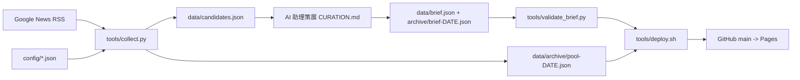

# 產業新聞觀察站 / Industry News Watch

每日 08:30(台灣時間)為半導體、晶片、AI 領域 B2B 科技媒體總編輯產出「**今日必讀 20 則**」編輯簡報,並累積保存所有蒐集到的新聞供查詢。

- 網站:<https://ma-kus.github.io/news-watch/>(GitHub Pages,由 `main` 根目錄提供)
- 目前版本:**v2.1.0**(見 [CHANGELOG](CHANGELOG.md))

## 功能
- **今日必讀**:20 則精選(中英對照標題、為何重要、報導角度、原文連結)+ 雙視角分析(總編輯 / CEO‧COO),可切換或並排,`#n` 可跳轉到對應新聞。
- **全部新聞**:每日累積的完整新聞池,全文搜尋,依日期、領域、公司、語言、來源篩選,標示是否入選當日 20 則。
- **條件設定**:四大視角(A–D)開關與權重、關注公司清單、加分關鍵字、排除關鍵字、台灣/全球比重、今日額外關注、意外重要名額(W)。設定存在瀏覽器 localStorage,複製 JSON 給助理套用。

## 架構(摘要)

詳見 [docs/ARCHITECTURE.md](docs/ARCHITECTURE.md)。

## 目錄結構
| 路徑 | 說明 |
|---|---|
| `index.html` `app.js` `style.css` | 靜態單頁 App(Pages 由根目錄提供,**勿移動**) |
| `config/` | `preferences.json` `watchlist.json` `lenses.json` |
| `data/` | `brief.json`(最新簡報)、`archive/`(每日 pool、brief 與索引) |
| `tools/` | `collect.py` `validate_brief.py` `deploy.sh` `server.py` |
| `CURATION.md` | AI 助理每日策展規範與 brief schema |
| `docs/` | 需求、架構、決策、營運、開發紀錄 |

## 快速開始
```bash
git clone https://github.com/Ma-kus/news-watch && cd news-watch
python3 tools/collect.py                 # 產生 data/candidates.json 與 data/archive/pool-DATE.json(僅需 Python 3 標準函式庫)
# 由助理(或人工)依 CURATION.md 撰寫 data/brief.json 並複製為 data/archive/brief-DATE.json
python3 tools/validate_brief.py          # 必須顯示 OK
python3 tools/server.py 8080             # 本機預覽 http://localhost:8080
tools/deploy.sh                          # 收集、同步、commit、push(需有 push 權限)
```

## 文件
- [需求](docs/REQUIREMENTS.md) · [架構](docs/ARCHITECTURE.md) · [決策 ADR](docs/DECISIONS.md) · [營運手冊](docs/OPERATIONS.md) · [開發紀錄](docs/DEVELOPMENT_LOG.md) · [變更紀錄](CHANGELOG.md) · [策展規範](CURATION.md)

## 已知限制
- 標題與來源為主,**未逐篇閱讀全文**;分析僅依標題/來源,未證實消息會標示。
- 新聞連結為 Google News 轉址連結。
- Pages 為靜態網站,設定無法寫回伺服器,需複製 JSON 給助理。
- 網站為公開;內容皆為公開新聞。
- 本專案未附授權條款(保留所有權利),如需開源請另行加入 LICENSE。
