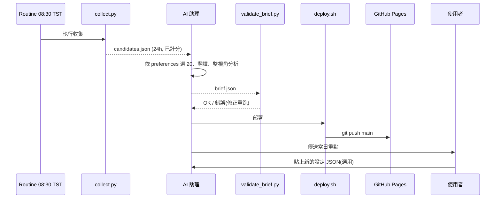
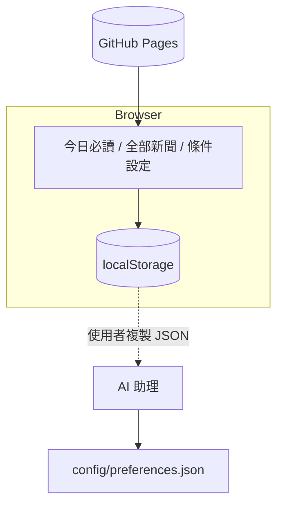

# 架構 (Architecture)

## 1. 元件
| 元件 | 角色 |
|---|---|
| `tools/collect.py` | 讀 `config/*.json`,對 Google News RSS 並行查詢(視角、公司、額外關注、wildcard),去重、計分,輸出候選池與每日 pool |
| AI 助理(依 `CURATION.md`) | 選 20 則、翻譯、撰寫雙視角分析,寫出 `brief.json` |
| `tools/validate_brief.py` | 驗證 brief 結構與 URL 皆來自候選池 |
| `tools/deploy.sh` | 收集、更新 brief 索引、同步檔案、commit、push |
| `index.html` `app.js` `style.css` | 靜態 SPA,讀取 `data/` JSON |
| GitHub Pages | 由 `main` 根目錄提供網站 |
| 排程 | 每日 08:30 Asia/Taipei(routine `automation-1792071396324`) |

## 2. 資料流




## 3. 目錄
```
index.html app.js style.css      # Pages 根目錄檔案
config/{preferences,watchlist,lenses}.json
data/brief.json                  # 最新簡報
data/archive/pool-YYYY-MM-DD.json  brief-YYYY-MM-DD.json  pool-index.json  brief-index.json
tools/  CURATION.md  docs/
```
`data/candidates.json` 僅在工作目錄產生(不入版控)。

## 4. Schemas
### 4.1 candidates.json
```json
{ "date": "YYYY-MM-DD", "generated_at": "ISO8601", "window_hours": 24, "count": 0,
  "dropped_by_exclude": 0, "preferences_snapshot": {}, "queries_run": [],
  "candidates": [
    { "id": 1, "title": "", "source": "", "url": "", "published_at": "ISO8601", "lang": "zh|en",
      "lens": ["A","B"], "companies": ["TSMC"], "keywords": ["AI"],
      "region": "taiwan|global", "taiwan_related": true, "score": 15.4,
      "focus": false, "wildcard": false } ] }
```
計分:視角權重、關注公司、加分關鍵字(每則最多計 3 個,每個 0.7)、台灣關聯等;命中排除詞者剔除。實際以 `tools/collect.py` 為準。
### 4.2 pool-DATE.json
`{ "date", "generated_at", "count", "items": [ ...候選欄位... ] }`(壓縮 JSON,全部新聞分頁資料來源)。
### 4.3 brief.json
完整欄位與驗證規則見 [CURATION.md](../CURATION.md)。重點:
- `date`, `generated_at`, 選填 `analysis`
- `analysis_editor`: `persona_title`, `summary`(≥2 段), `implications_taiwan`(≥3), `story_angles`(≥3), `questions_to_track`(≥4)
- `analysis_executive`: `persona_title`, `summary`(≥2 段), `implications_taiwan`, `decision_considerations`(≥3), `questions_to_track`
- `items`: 恰 20 筆,`rank`, `category`(A|B|C|D|W), `title_original/zh/en`, `source`, `url`, `published_at`, `why_it_matters`, `angle`, `companies`
### 4.4 preferences.json
```json
{ "version": 1,
  "lenses": { "A": {"enabled": true, "weight": 5}, "B": {...4}, "C": {...3}, "D": {...2} },
  "watchlist_companies": ["Google", "TSMC", "..."],
  "boost_keywords": ["AI", "CoWoS", "..."],
  "exclude_keywords": ["優惠", "開箱"],
  "region_weight": {"taiwan": 60, "global": 40},
  "extra_focus_today": "",
  "wildcard_slots": 3 }
```
### 4.5 索引
`brief-index.json`:有簡報的日期陣列;`pool-index.json`:`[{date,count,brief}]`。

## 5. 設計取捨
- 收集(確定性、腳本)與判斷(選稿、翻譯、分析、AI)分離。
- 全站靜態,以 JSON 為介面,Pages 免費託管。
- 詳見 [DECISIONS.md](DECISIONS.md)。
